# Two-Wedge Friction Problem: Minimum Pull-Out Force

End-semester project for **Computational Engineering Mechanics 1** (B.Tech in Computer Science Engineering, Artificial Intelligence, Amrita School of Engineering, Bangalore, 2022). The project finds the minimum force **P** needed to pull a bottom wedge out from under a loaded top wedge, solved by hand with free body diagrams and checked with a MATLAB implementation.


## Problem

Two wedges are stacked between a floor (C) and a wall (D), as shown. A vertical load acts on the top wedge **B**, and a horizontal force **P** pulls the bottom wedge **A** out. Both wedge faces are inclined at 15°.

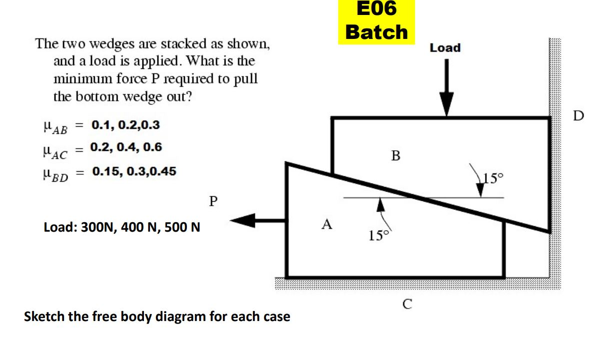

Three cases are analysed:

| Case | Load (N) | μ<sub>AB</sub> | μ<sub>AC</sub> | μ<sub>BD</sub> |
|:-:|:-:|:-:|:-:|:-:|
| 1 | 300 | 0.10 | 0.20 | 0.15 |
| 2 | 400 | 0.20 | 0.40 | 0.30 |
| 3 | 500 | 0.30 | 0.60 | 0.45 |

(μ<sub>AB</sub> is the friction between A and B, μ<sub>AC</sub> between A and the floor, and μ<sub>BD</sub> between B and the wall.)

## Method

Because many forces act, the problem is solved with free body diagrams (FBDs), one per wedge. When the bottom wedge A is pulled out, B is pushed against the wall D and slides down, while friction from A tries to drag it away from the wall. Friction is taken at its limiting value, F<sub>S</sub> = μ F<sub>R</sub>, and the weights of the wedges are neglected.

| Wedge B | Wedge A |
|:-:|:-:|
| 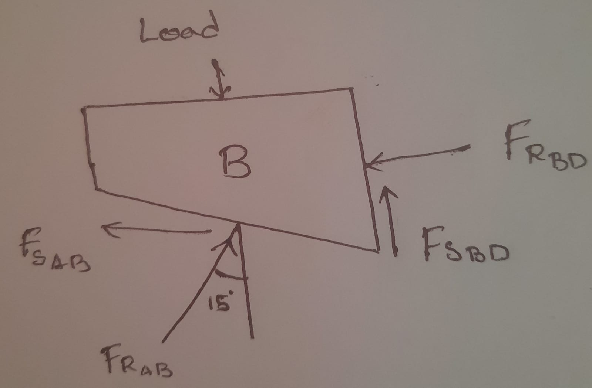 | 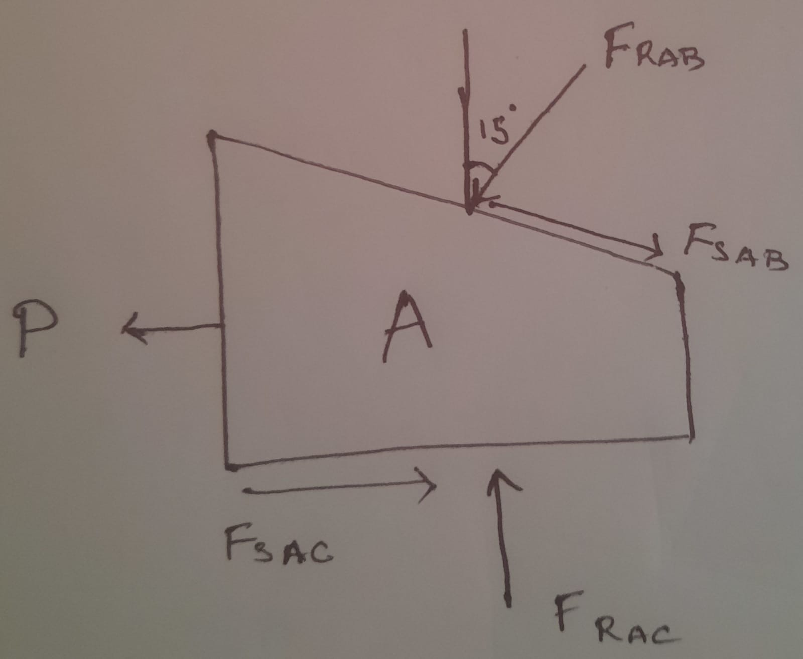 |

### Equations

With θ = 15°:

**Wedge B** (ΣF<sub>x</sub> = 0 and ΣF<sub>y</sub> = 0):

$$F_{R,BD} = F_{R,AB}\,(\sin\theta - \mu_{AB}\cos\theta)$$

$$\text{Load} = F_{R,AB}\cos\theta + \mu_{AB}F_{R,AB}\sin\theta + \mu_{BD}F_{R,BD}$$

Solving for the normal force between the wedges:

$$F_{R,AB} = \frac{\text{Load}}{\cos\theta + \mu_{AB}\sin\theta + \mu_{BD}\,(\sin\theta - \mu_{AB}\cos\theta)}$$

**Wedge A** (ΣF<sub>y</sub> = 0 and ΣF<sub>x</sub> = 0):

$$F_{R,AC} = F_{R,AB}\cos\theta + F_{S,AB}\sin\theta$$

$$P = F_{S,AC} + F_{S,AB}\cos\theta - F_{R,AB}\sin\theta, \qquad F_{S,AB} = \mu_{AB}F_{R,AB},\; F_{S,AC} = \mu_{AC}F_{R,AC}$$

## Results

| Case | Load (N) | P, hand calculation (N) | P, MATLAB (N) |
|:-:|:-:|:-:|:-:|
| 1 | 300 | 10.662 | 10.6683 |
| 2 | 400 | 131.63 | 131.6555 |
| 3 | 500 | 320.1 | 319.0929 |

The hand calculations and the code agree to within about 0.3%; the differences come from rounding in the hand work. Intermediate forces for each case:

| Case | F<sub>R,AB</sub> (N) | F<sub>S,AB</sub> (N) | F<sub>R,AC</sub> (N) | F<sub>S,AC</sub> (N) |
|:-:|:-:|:-:|:-:|:-:|
| 1 | 295.234 | 29.523 | 292.816 | 58.563 |
| 2 | 385.587 | 77.117 | 392.408 | 156.963 |
| 3 | 485.607 | 145.682 | 506.765 | 304.059 |

### Notes and limitations

- For case 3, μ<sub>AB</sub> = 0.30 is larger than tan 15° ≈ 0.268, so the wall reaction F<sub>R,BD</sub> comes out slightly negative (about −15 N). A wall can only push, so case 3 lies outside the range where this model strictly applies, and its result should be read with care.
- The report numbers the cases in the order 300 N, 500 N, 400 N. This README uses the order given in the problem statement (300 N, 400 N, 500 N).

<details>
<summary>Handwritten solutions from the report</summary>

**Case 1: load 300 N**

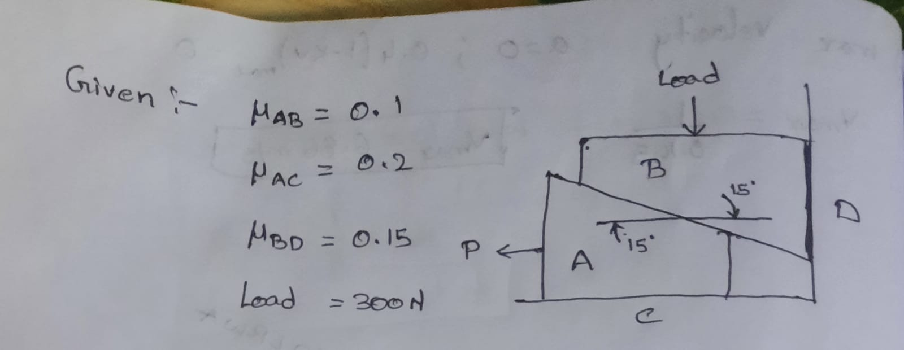
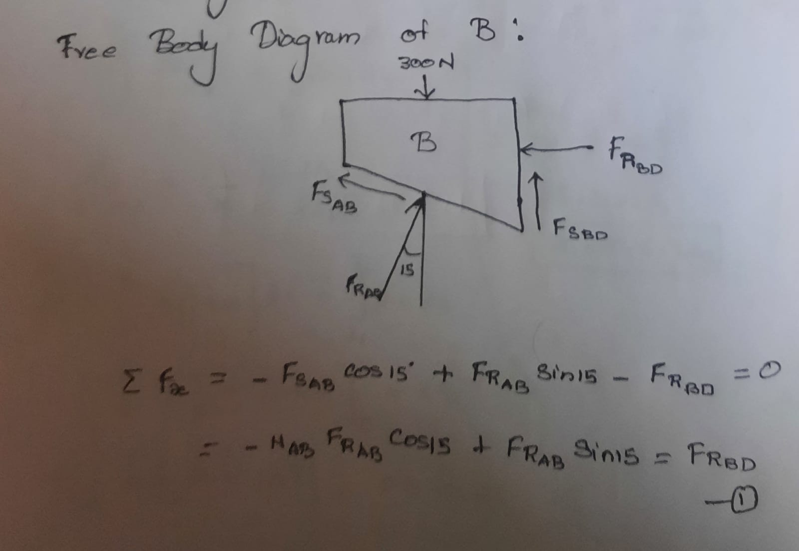
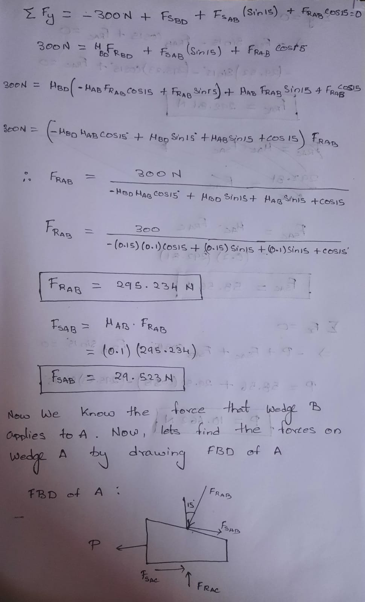
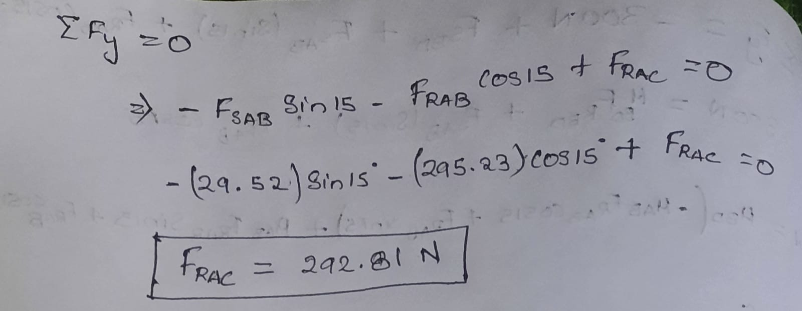
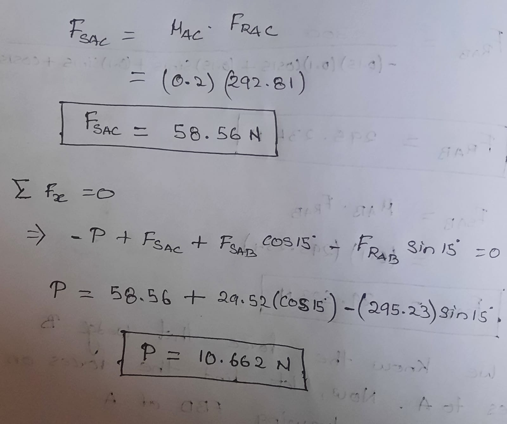

**Case 2: load 400 N**

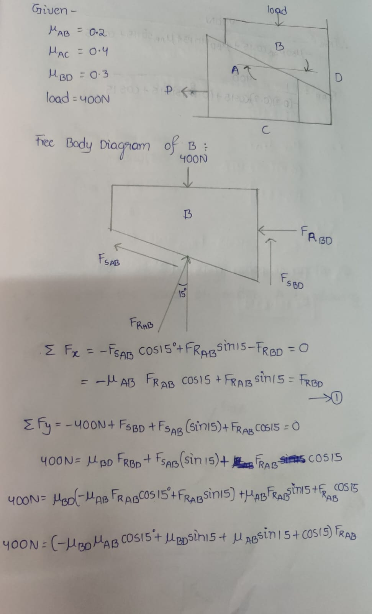
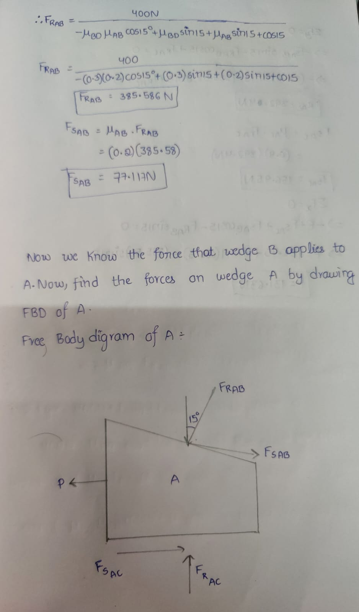
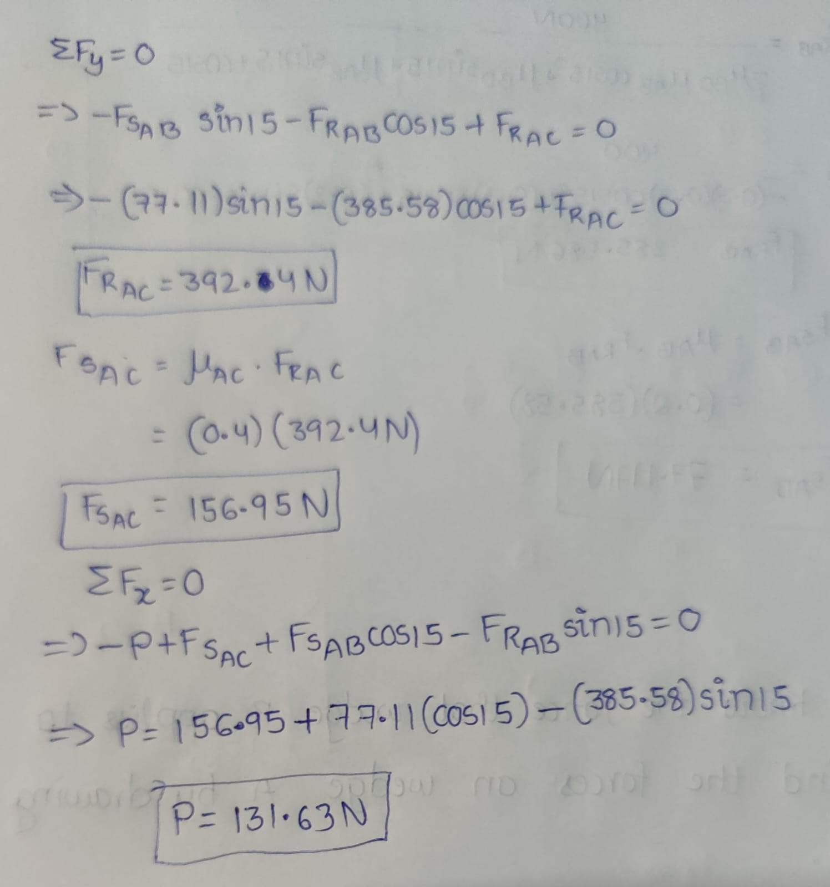

**Case 3: load 500 N**

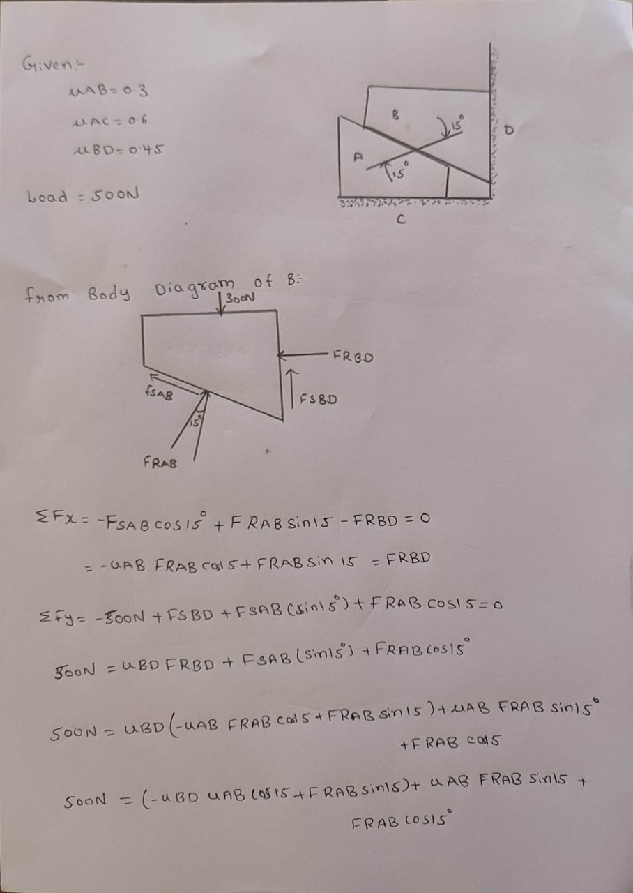
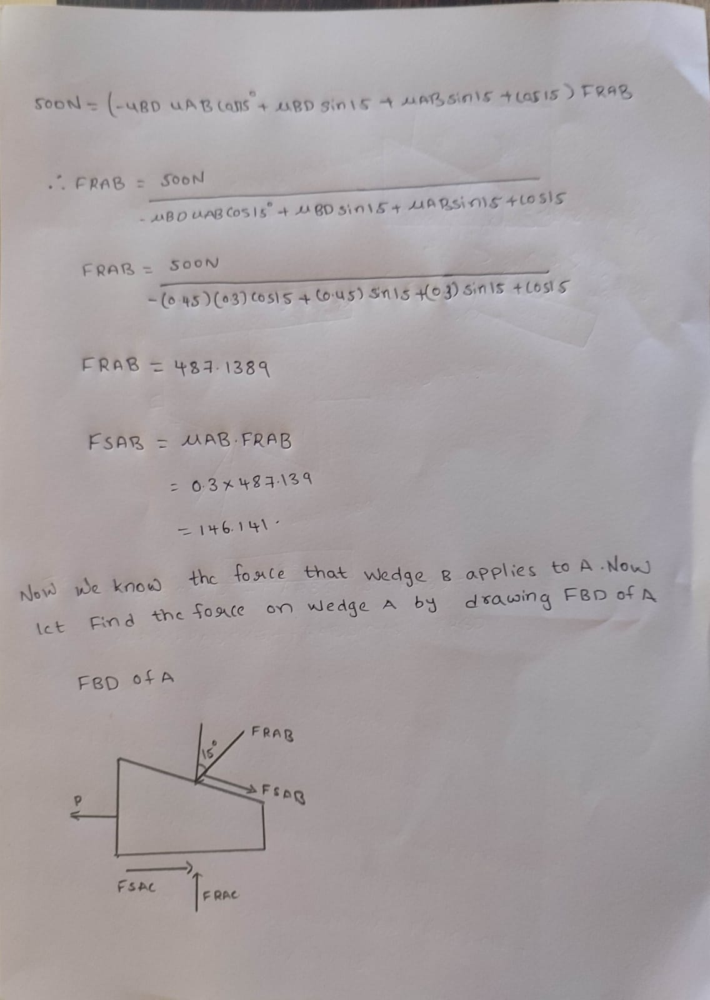
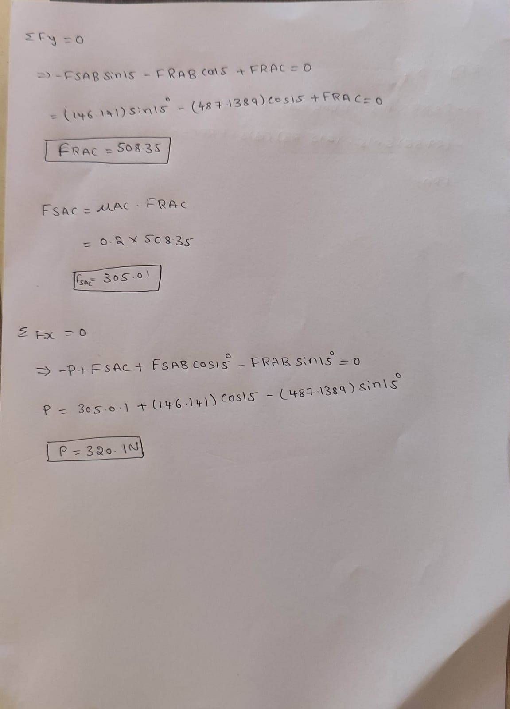

**Hand calculation vs MATLAB (as tabulated in the report)**


</details>

## Code

| File | Purpose |
|:--|:--|
| [`src/wedge_pull_force.m`](src/wedge_pull_force.m) | Function that returns the contact forces and the pull-out force P for given load, friction coefficients and wedge angle |
| [`src/run_cases.m`](src/run_cases.m) | Script that evaluates the three cases above and prints a results table |

To reproduce the results, open MATLAB in the `src/` folder and run:

```matlab
run_cases
```

To use the function directly:

```matlab
r = wedge_pull_force(300, 0.1, 0.2, 0.15);   % load [N], muAB, muAC, muBD
r.P                                           % about 10.668 N
```

The original script read the load as a typed input but ignored it (the value 300 was hard-coded) and shadowed MATLAB's built-in `load` function. The function above takes every parameter as an argument, including the wedge angle (default 15°).

## Repository structure

```text
.
├── src/
│   ├── wedge_pull_force.m
│   └── run_cases.m
├── docs/
│   ├── CEM1-End-Sem-Report.docx
│   ├── CEM1-End-Sem-Presentation.pptx
│   └── images/
└── README.md
```
